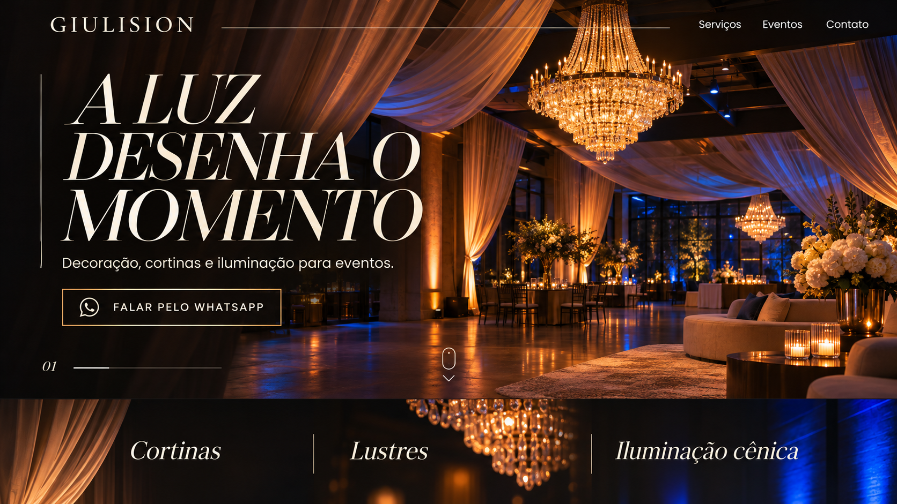
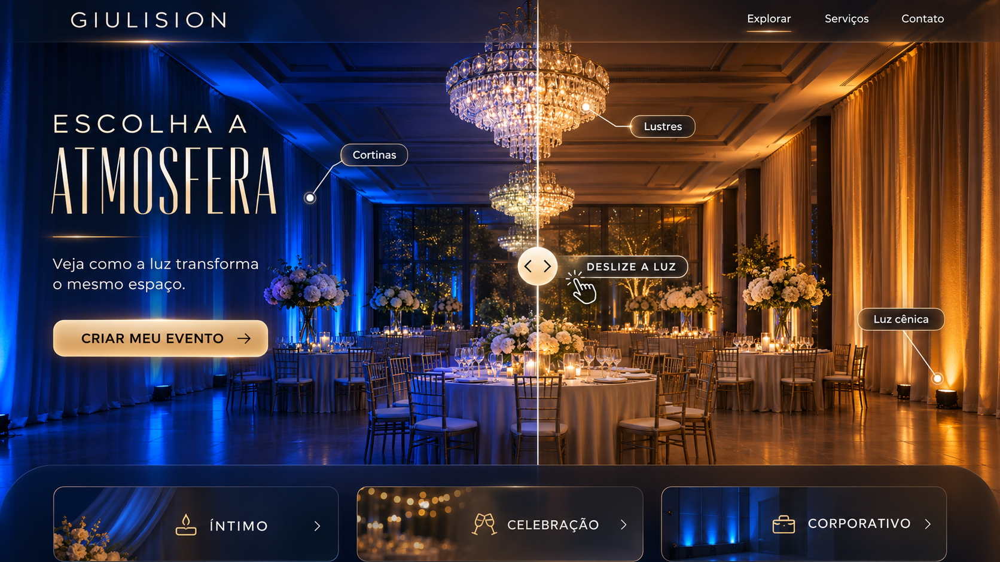
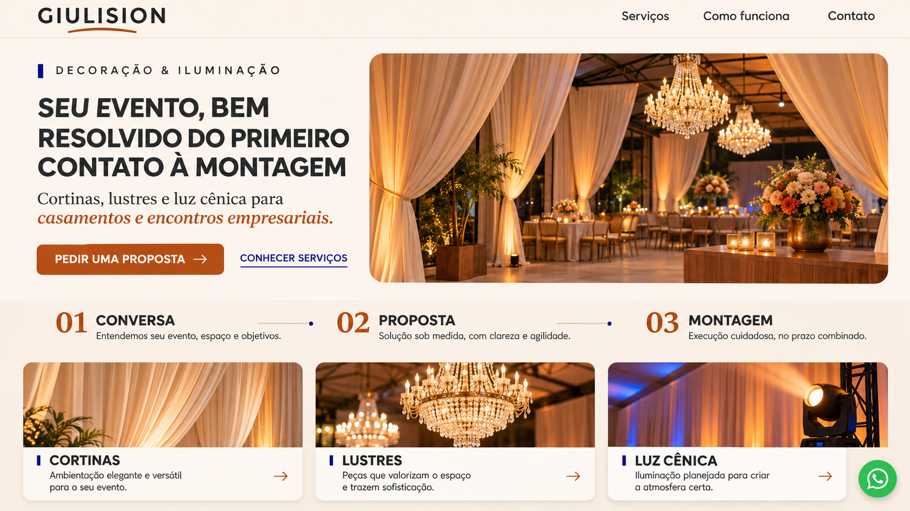
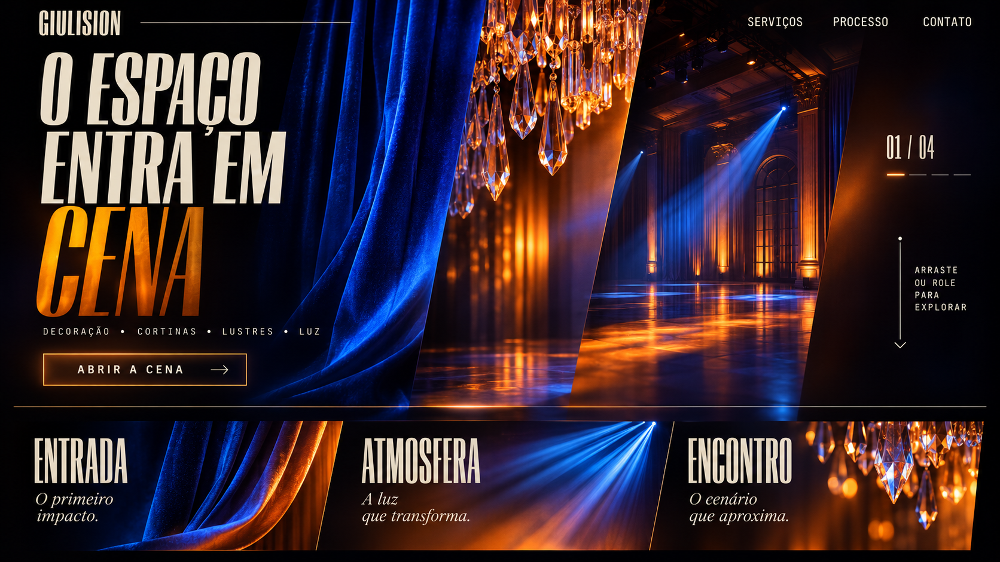

# Estudo de mercado e direções criativas — Giulision

Data: 9 de novembro de 2026

> “Giulision” é um nome provisório do projeto. As imagens desta apresentação são explorações geradas por IA e não representam obras executadas, clientes ou portfólio real.

## 1. Diagnóstico do briefing

### Confirmado

- Site institucional simples, em formato one-page.
- Serviços citados: decoração de eventos, iluminação decorativa/cênica, cortinas e lustres.
- Contextos citados: casamentos e confraternizações/encontros empresariais.
- Conversão principal: contato direto por WhatsApp ou telefone.
- Direção inicial: visual editorial e fotográfico, com carvão, off-white, âmbar e possibilidade de azul.

### Ainda não confirmado

- Nome oficial, logotipo e identidade visual.
- Operação real, responsável e autorização para uso comercial.
- Cidade/região de atendimento.
- Serviços finais, diferenciais e forma de contratação.
- Número de WhatsApp/telefone.
- Portfólio real, clientes, depoimentos, resultados e direitos de imagem.
- Domínio, hospedagem e responsáveis pela publicação.

### Oportunidade

O site pode transformar iluminação em demonstração visual, em vez de apenas listar serviços. A experiência ideal combina atmosfera, clareza de processo e contato imediato, sem fabricar prova social.

## 2. Mercado e concorrência

### Padrões observados

- Fotografia em grande escala sustenta a percepção de qualidade.
- Portfólio real costuma ser a principal prova de confiança.
- Sites fortes explicam processo e logística para reduzir risco percebido.
- WhatsApp, orçamento e início de projeto são os CTAs recorrentes.
- Casamentos e corporativo aparecem como jornadas distintas.

### Benchmarks diretos

| Referência | O que funciona | Aprendizado adaptável |
|---|---|---|
| [KG Design de Eventos](https://kathyanagarcia.com.br/cenografia-aerea.html) | Especialização clara; estética ligada a cálculo, segurança e montagem | Unir atmosfera a domínio técnico |
| [Estúdio 1010](https://estudio1010.com.br/) | Jornada do briefing à entrega; social e corporativo; CTA claro | Mostrar processo em três etapas |
| [Verde Musgo](https://verdemusgo.com.br/) | Linguagem emocional e fotografia como prova | Vender sensação antes de detalhar itens |
| [WAVE Cenografia](https://wavecenografia.com.br/cenografia-para-eventos-corporativos-em-sao-paulo) | Conteúdo específico por formato e local; proposta direta | Nomear entregáveis com precisão |
| [CG Cenografia](https://www.cgcenografia.com.br/) | Amplitude, FAQ e orçamento por WhatsApp | Contato imediato e objeções respondidas |

### Referências de posicionamento premium

- [Birch Events](https://birchevents.com/): linguagem de marca autoral, imagens grandes e forte senso de exclusividade.
- [Revelry Event Designers](https://www.revelryeventdesigners.com/): transforma acervo, iluminação, tecidos e fabricação em ecossistema visual.
- [KG Design de Eventos](https://kathyanagarcia.com.br/cenografia-aerea.html): eleva uma especialidade concreta a assinatura de marca.

### Experiências de outros segmentos

- [True Staging](https://www.truestaging.co.uk/): reduz o posicionamento a uma frase forte e deixa o trabalho físico dominar a tela.
- [Moooi — A Life Extraordinary](https://www.moooi.com/us/a-life-extraordinary): ambientes digitais como jornada de descoberta e mudança de atmosfera.
- [Spireworks](https://www.spireworks.org/): interação com luz como produto, não como ornamento.
- [TAIT Live Experience](https://www.taittowers.com/live): grandes experiências organizadas por capacidades e estudos de caso.
- [SiteInspire — Events](https://www.siteinspire.com/websites/category/events): referência de composição tipográfica, portfólio e navegação no setor de eventos.

## 3. Matriz técnica

| Recurso | Uso proposto | Licença/custo | Esforço | Mobile e desempenho | Decisão preliminar |
|---|---|---|---|---|---|
| CSS + IntersectionObserver | Revelações, progressos e microinterações | Nativo | Baixo | Excelente | Base recomendada |
| [Motion](https://motion.dev/docs/react-accessibility) | Transições, presença, gestos e reduced motion | MIT; recursos Plus opcionais | Baixo–médio | Bom com moderação | Recomendado se a stack for React |
| [GSAP + ScrollTrigger](https://gsap.com/docs/v3/Plugins/ScrollTrigger/) | Narrativa por rolagem e painéis coreografados | Gratuito inclusive para uso comercial sob licença padrão | Médio | Bom com `matchMedia` e fallback | Recomendado para A/D |
| [Lenis](https://github.com/darkroomengineering/lenis) | Inércia sutil de rolagem | MIT | Médio | Tem limitações no Safari e low-power | Opcional; não é necessário para o MVP |
| [React Bits](https://github.com/DavidHDev/react-bits) | Efeitos de luz e backgrounds adaptados | MIT + Commons Clause | Médio | Varia por componente | Usar apenas trechos revisados e avisos de terceiros |
| [Aceternity UI](https://ui.aceternity.com/explore) | Referência/atalho para efeitos e cartões | Componentes gratuitos e blocos Pro; validar licença por item | Médio | Varia muito | Não instalar antes da direção aprovada |
| [Three.js](https://threejs.org/docs/) | Luz procedural/ambiente 3D | MIT | Alto | Exige fallback e orçamento de GPU | Somente se o conceito D for escolhido |

Princípio de acessibilidade: toda animação terá alternativa estática e respeitará `prefers-reduced-motion`.

## 4. Direções criativas

### A — Luz que desenha o momento

- Ideia: apresentação cinematográfica editorial, com fotografia em tela cheia e tipografia de luxo.
- Sensação: sofisticação, atmosfera e domínio estético.
- Público: casamentos de maior apelo visual e empresas que buscam recepção elegante.
- Paleta: carvão, marfim, âmbar e azul-cobalto.
- Tipografia: serif display de alto contraste + sans neutra.
- Primeira dobra: imagem dominante, promessa emocional e CTA de WhatsApp.
- Motion: revelação lenta, parallax discreto, transições de luz e progressão por seção.
- Referências: Birch Events, KG Design e True Staging.
- Técnica: GSAP/ScrollTrigger ou Motion; sem 3D.
- Conversão: alta, desde que o CTA permaneça visível.
- Limitação: depende fortemente de imagens autorizadas de excelente qualidade.

### B — Compositor de luz

- Ideia: o visitante altera a atmosfera do mesmo ambiente entre azul e âmbar.
- Sensação: descoberta, controle e transformação imediata.
- Público: casamentos, corporativo e parceiros que valorizam visualização prévia.
- Paleta: azul-noturno, cobalto, âmbar e marfim.
- Tipografia: grotesca geométrica + display condensada.
- Primeira dobra: comparador de luz arrastável com hotspots de cortina, lustre e luz cênica.
- Motion: divisor arrastável, hotspots, mudança de temperatura e cartões de atmosfera.
- Referências: Spireworks, Moooi e experiências de comparação visual.
- Técnica: CSS/React + Motion; WebGL desnecessário para a primeira versão.
- Conversão: alta, porque demonstra o valor antes do CTA.
- Limitação: precisa funcionar bem por toque e oferecer fallback estático.

### C — Evento bem resolvido

- Ideia: máxima clareza, processo simples e proposta comercial objetiva.
- Sensação: confiança, organização e facilidade.
- Público: empresas e clientes que priorizam previsibilidade e rapidez.
- Paleta: off-white, carvão, terracota/âmbar e detalhe azul.
- Tipografia: sans contemporânea + serif itálica pontual.
- Primeira dobra: promessa direta, imagem clara e CTA para proposta.
- Motion: feedbacks de botão, elevação sutil, progresso e entrada de cartões.
- Referências: Estúdio 1010, Verde Musgo e WAVE.
- Técnica: CSS + Motion opcional.
- Conversão: a mais alta entre as quatro direções.
- Limitação: é menos memorável se não incorporar uma demonstração visual exclusiva.

### D — O espaço entra em cena

- Ideia: transformar a navegação em abertura de palco, com cortinas, feixes e painéis.
- Sensação: ousadia, direção artística e espetáculo.
- Público: marcas, produtores e clientes que valorizam experimentação.
- Paleta: preto, ultramarino, âmbar intenso e marfim.
- Tipografia: grotesca ultracondensada + mono utilitária + serif itálica.
- Primeira dobra: três recortes cenográficos que se abrem conforme a rolagem.
- Motion: painéis coreografados, luz seguindo o cursor e transições de cena.
- Referências: TAIT, SiteInspire, Awwwards e Codrops.
- Técnica: GSAP/ScrollTrigger; Three.js somente se houver ganho comprovado.
- Conversão: média; o CTA precisa vencer a força experimental.
- Limitação: maior custo de produção, maior risco mobile e maior dependência de QA.

## 5. Comparação

Escala: 1 = baixo; 5 = alto. Em complexidade, 5 significa maior esforço/risco.

| Critério | A | B | C | D |
|---|---:|---:|---:|---:|
| Impacto visual | 5 | 5 | 4 | 5 |
| Originalidade | 4 | 5 | 3 | 5 |
| Adequação ao segmento | 5 | 5 | 5 | 4 |
| Clareza comercial | 4 | 4 | 5 | 3 |
| Facilidade de navegação | 4 | 4 | 5 | 3 |
| Potencial de conversão | 4 | 5 | 5 | 3 |
| Complexidade técnica | 3 | 4 | 2 | 5 |
| Qualidade provável no mobile | 4 | 3 | 5 | 2 |

## Recomendação

A melhor apresentação comercial é uma combinação controlada:

- base visual e tipografia do conceito A;
- demonstração de transformação de luz do conceito B;
- processo e CTA do conceito C;
- sem adotar a navegação experimental integral do conceito D.

Essa combinação mostra criatividade de alto nível, explica o serviço em segundos e preserva um caminho claro para contato.

## Ponto de aprovação

Escolher A, B, C, D ou uma combinação. Nenhuma implementação deve começar antes dessa decisão.

